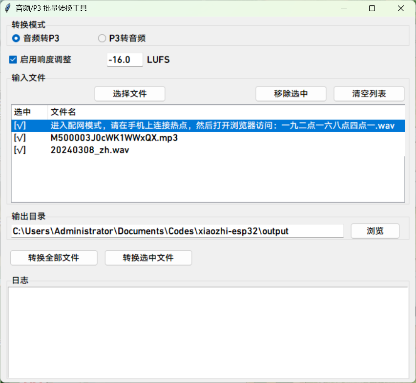

# P3 Audio Format Conversion and Playback Tools

This directory contains Python scripts for working with P3-format audio files:

## 1. Audio Conversion Tool (convert_audio_to_p3.py)

Converts a regular audio file into P3 format (a streaming structure of 4-byte headers + Opus data packets) and applies loudness normalization.

### Usage

```bash
python convert_audio_to_p3.py <input audio file> <output P3 file> [-l LUFS] [-d]
```

The optional `-l` flag sets the loudness-normalization target (default -16 LUFS); the optional `-d` flag disables loudness normalization.

If the input audio file meets any of the following conditions, it's recommended to use `-d` to disable loudness normalization:
- The audio is very short
- The audio's loudness has already been adjusted
- The audio comes from the default TTS (XiaoZhi's current default TTS loudness is already -16 LUFS)

Example:
```bash
python convert_audio_to_p3.py input.mp3 output.p3
```

## 2. P3 Audio Playback Tool (play_p3.py)

Plays a P3-format audio file.

### Features

- Decodes and plays P3-format audio files
- Applies a fade-out when playback ends or is interrupted by the user, to avoid clipping
- Supports specifying the file to play via a command-line argument

### Usage

```bash
python play_p3.py <P3 file path>
```

Example:
```bash
python play_p3.py output.p3
```

## 3. Convert-Back Tool (convert_p3_to_audio.py)

Converts a P3-format file back into a regular audio file.

### Usage

```bash
python convert_p3_to_audio.py <input P3 file> <output audio file>
```

The output audio file needs a file extension.

Example:
```bash
python convert_p3_to_audio.py input.p3 output.wav
```
## 4. Audio/P3 Batch Conversion Tool

A graphical tool that supports batch conversion from audio to P3, and from P3 to audio.



### Usage:
```bash
python batch_convert_gui.py
```

## Installing Dependencies

Before using these scripts, make sure the required Python libraries are installed:

```bash
pip install librosa opuslib numpy tqdm sounddevice pyloudnorm soundfile
```

Or use the provided requirements.txt file:

```bash
pip install -r requirements.txt
```

## P3 Format Description

P3 is a simple streaming audio format, structured as follows:
- Each audio frame consists of a 4-byte header plus an Opus-encoded data packet
- Header format: [1-byte type, 1-byte reserved, 2-byte length]
- Sample rate is fixed at 16000Hz, mono
- Each frame is 60ms long
